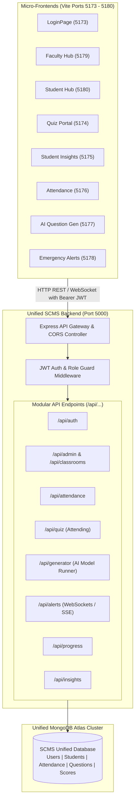
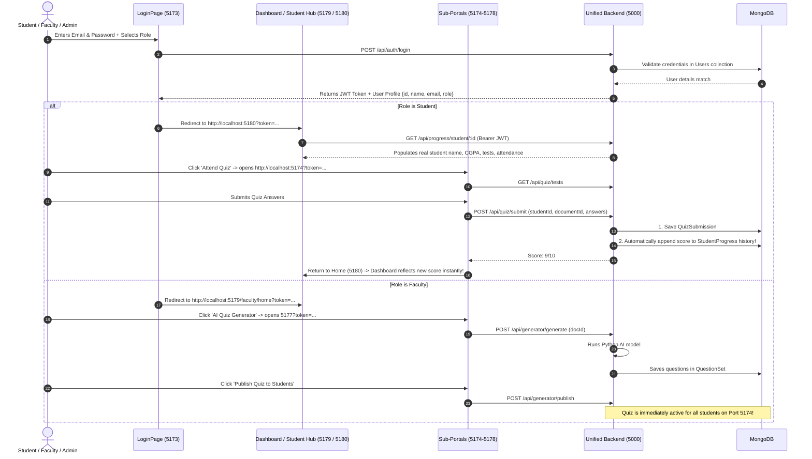
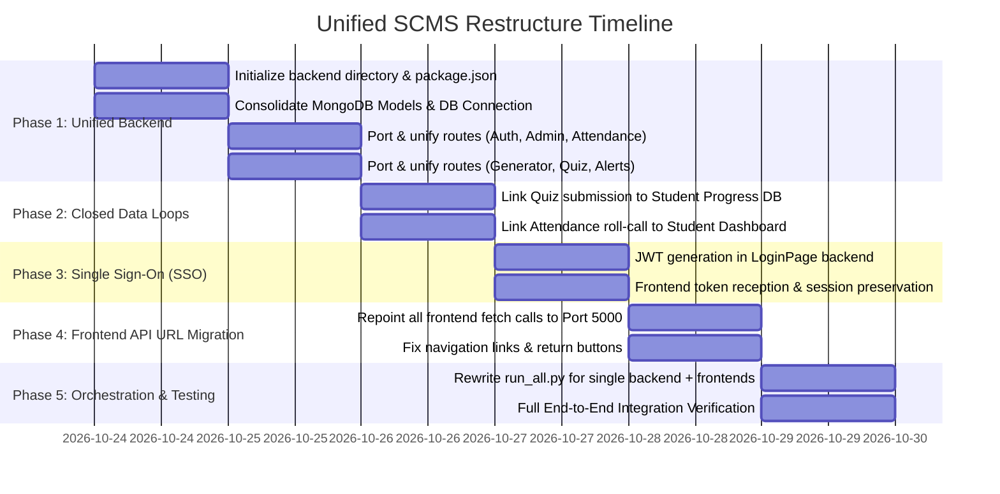

# Architectural Restructuring Plan: Unified Single Backend & Cohesive Flow
**Smart Classroom Management System (SCMS)**

---

## 1. Executive Vision & Objectives

Currently, SCMS runs **8 separate Express backend servers** on disparate ports (`8000`, `8001`, `8002`, `8003`, `8004`, `8005`, `8006`, `5000`) connecting to disconnected database schemas across multiple MongoDB clusters. This fragmentation causes:
- Broken cross-app authentication (no Single Sign-On).
- Data isolation (quiz results do not flow into student performance; attendance does not update student dashboards).
- Extreme operational friction (requiring 16+ separate terminals to run).

### The New Architecture
We will consolidate all backend operations into **one single, high-performance Node.js / Express backend** (running on **`http://localhost:5000`**), while linking all frontend portals into an unbroken, synchronized user flow.



---

## 2. Before vs. After Comparison

| Architectural Aspect | Current Fragmented State (Before) | Unified Single-Backend State (After) |
|---|---|---|
| **Backend Servers** | 8 isolated Node servers on 8 different ports | **1 Unified Node/Express Server on Port 5000** |
| **Backend Processes** | 8 `server.js` instances spawned in 8 terminals | **1 `npm run dev` or `node server.js` process** |
| **Authentication** | Session cookies scoped only to port 8000; other ports don't know who is logged in | **Unified JWT Bearer token SSO** shared seamlessly across all frontends |
| **Quiz Data Flow** | Generated in 8004, attended in 8001, never saved to student progress in 8006 | **Closed loop**: Quiz taken on 5174 immediately posts to student history in progress (5180) and insights (5175) |
| **Attendance Flow** | Attendance saved in 8003, student dashboard shows dummy attendance from 8006 | **Live sync**: Daily roll-call calculates real attendance % on student progress cards |
| **Emergency Alerts** | File-based JSON on 8005 polled by frontends | **Instant broadcast** via `/api/alerts` (or Server-Sent Events / Socket.io) |
| **`run_all.py` Execution** | Spawns 11 command windows, fails due to path mismatches | **Clean orchestration**: 1 command for backend + automated frontend launching |

---

## 3. Directory Layout for Unified Backend

We will introduce a top-level `backend/` directory in the project root:

```text
C:\Users\Hariharan Raptee\FInal\
├── backend/                               <-- UNIFIED BACKEND SERVER
│   ├── config/
│   │   ├── db.js                          # MongoDB connection with Mongoose
│   │   └── jwt.js                         # JWT secrets and token helpers
│   ├── middleware/
│   │   ├── authMiddleware.js              # Token validation & req.user injection
│   │   ├── roleGuard.js                   # Role verification (student, faculty, admin)
│   │   └── errorHandler.js                # Centralized error handler
│   ├── models/
│   │   ├── User.js                        # Unified user model (Student, Faculty, Admin)
│   │   ├── Attendance.js                  # Daily attendance & sessions
│   │   ├── Classroom.js                   # Classroom inventory & bookings
│   │   ├── Document.js                    # Uploaded study docs & syllabi
│   │   ├── QuestionSet.js                 # Questions generated & published tests
│   │   ├── QuizSubmission.js              # Student quiz attempts, scores & answers
│   │   ├── StudentProfile.js              # Roll no, semester, CGPA history, stats
│   │   └── Alert.js                       # Emergency siren status & logs
│   ├── controllers/
│   │   ├── authController.js
│   │   ├── adminController.js
│   │   ├── attendanceController.js
│   │   ├── generatorController.js         # Handles doc upload & python NLP invocation
│   │   ├── quizController.js              # Serves questions & grades submissions
│   │   ├── alertController.js             # Emergency siren toggle & live status
│   │   ├── progressController.js          # Student academic progress & CGPA
│   │   └── insightsController.js          # Faculty class analytics & marks editor
│   ├── routes/
│   │   ├── authRoutes.js                  # /api/auth/*
│   │   ├── adminRoutes.js                 # /api/admin/*, /api/classrooms/*, /api/bookings/*
│   │   ├── attendanceRoutes.js            # /api/attendance/*
│   │   ├── generatorRoutes.js             # /api/generator/*
│   │   ├── quizRoutes.js                  # /api/quiz/*
│   │   ├── alertRoutes.js                 # /api/alerts/*
│   │   ├── progressRoutes.js              # /api/progress/*
│   │   └── insightsRoutes.js              # /api/insights/*
│   ├── python_ai/                         # NLP & Question generation model
│   │   ├── topic_doc_question_generator.py
│   │   ├── ai_model_runner.py
│   │   └── finalmodel/
│   ├── uploads/                           # Uploaded PDF/TXT syllabus files
│   ├── .env                               # Consolidated environment variables
│   ├── package.json
│   └── server.js                          # Central entry point (Port 5000)
├── Faculty and Admin/
│   ├── DashboardFINAL/Dashboard/frontend/ # Port 5179
│   ├── StudentInsights/StudentInsights/frontend/ # Port 5175
│   ├── AttendanceFINAL/AttendanceFINAL/frontend/ # Port 5176
│   ├── QuestionGenerator/QuestionGenerator/   # Port 5177 (frontend only)
│   └── AlertSystem/AlertSystem/               # Port 5178 (frontend only)
├── LoginPage/frontend/                        # Port 5173
├── Student Page/
│   ├── student_progress_connectedFINAL/frontend/ # Port 5180
│   └── Quiz attending/Horizons Student Dashboard/ # Port 5174 (frontend only)
├── run_all.py                                 # Streamlined launcher script
└── PLAN.md                                    # This plan document
```

---

## 4. Single Flow Lifecycle (End-to-End User Journeys)



---

## 5. Consolidated API Route Specification

The single backend on `http://localhost:5000` will expose the following unified routes:

### A. Authentication & Users (`/api/auth`)
- `POST /api/auth/register` - Create student, faculty, or admin account with hashed password.
- `POST /api/auth/login` - Authenticate, issue JWT token, and return profile.
- `GET /api/auth/me` - Validate active token and return current user state.
- `POST /api/auth/logout` - Invalidate session / client token flush.

### B. Admin & Classrooms (`/api/admin`)
- `GET /api/admin/classrooms` - List available classrooms and equipment.
- `POST /api/admin/bookings` - Create classroom schedule reservation.
- `GET /api/admin/bookings` - Retrieve active bookings and timetable.
- `DELETE /api/admin/bookings/:id` - Cancel reservation.

### C. Attendance System (`/api/attendance`)
- `GET /api/attendance/students` - Get active student roster for attendance marking.
- `POST /api/attendance/submit` - Record present/absent roll-call for date and subject.
- `GET /api/attendance/today` - Today's attendance percentage and metrics.
- `GET /api/attendance/history` - Historical sessions and absentee logs.
- `GET /api/attendance/student/:id` - Calculated attendance rate for an individual student (powers the student progress gauge).

### D. AI Question & Quiz Generator (`/api/generator`)
- `POST /api/generator/upload` - Upload course material (PDF/TXT) and parse text.
- `GET /api/generator/documents` - Fetch uploaded documents list.
- `DELETE /api/generator/documents/:id` - Remove document.
- `POST /api/generator/generate` - Execute Python NLP runner (`topic_doc_question_generator.py`) and return generated MCQs.
- `POST /api/generator/save` - Save/update question bank for the document.
- `POST /api/generator/publish` - Publish quiz into student-facing tests collection.

### E. Student Quiz Portal (`/api/quiz`)
- `GET /api/quiz/tests` - List available quizzes published by faculty.
- `GET /api/quiz/questions/:testId` - Retrieve quiz questions (with answers omitted for security).
- `POST /api/quiz/submit` - Submit student responses, evaluate grade, record `QuizSubmission`, and **automatically sync score into Student Progress history**.

### F. Student Academic Progress (`/api/progress`)
- `GET /api/progress/student/:id` - Student metadata, profile, academic standing.
- `GET /api/progress/subjects/:id` - Subject marks and test history (updated dynamically by quiz submissions).
- `GET /api/progress/cgpahistory/:id` - Semester-by-semester GPA trends.
- `GET /api/progress/performance/:id` - Monthly performance chart data.

### G. Student Insights & Faculty Grading (`/api/insights`)
- `GET /api/insights/classes` - Class-wide performance overview.
- `GET /api/insights/students` - All students with aggregate marks and letter grades.
- `PUT /api/insights/student/:id` - Faculty mark editor to update scores manually.

### H. Emergency Alert System (`/api/alerts`)
- `GET /api/alerts/status` - Current alarm state (`{ isActive: boolean, message: string, timestamp: Date }`).
- `POST /api/alerts/on` - Faculty/Admin triggers emergency siren.
- `POST /api/alerts/off` - Faculty/Admin deactivates emergency siren.
- *(Optional Enhancement)*: SSE stream `GET /api/alerts/stream` for 0ms instantaneous push notification to all open browser tabs.

---

## 6. Implementation Roadmap & Phases



### Phase 1: Construct the Unified Backend (`backend/`)
1. Create `backend/` directory structure with `package.json`, installing `express`, `mongoose`, `cors`, `dotenv`, `jsonwebtoken`, `bcryptjs`, `multer`.
2. Consolidate Mongoose schemas into `backend/models/`.
3. Migrate controller and route logic from all 8 services into clean modular files under `backend/routes/`.
4. Migrate Python AI runner scripts (`topic_doc_question_generator.py`) into `backend/python_ai/`.
5. Connect to MongoDB and verify the unified server boots cleanly on port `5000`.

### Phase 2: Wire the Closed Data Loops
1. **Quiz ➔ Progress Link**: When `/api/quiz/submit` is called:
   - Compute the score.
   - Insert record into `QuizSubmission`.
   - Update the student's `Subject` entry in `StudentProfile` so the progress dashboard (5180) updates automatically.
2. **Attendance ➔ Progress Link**: When `/api/attendance/submit` is called:
   - Calculate present vs total sessions per student.
   - Expose this live metric on `/api/progress/student/:id` for real-time attendance percentage rendering.

### Phase 3: Unified Single Sign-On (SSO) & Navigation Flow
1. In `LoginPage/frontend`, after successful login, store `{ token, user }` in `localStorage` and forward via query param (`?token=...&role=...`).
2. Update `FacultyDashboard` (5179) and `StudentProgress` (5180) to read the token and fetch authenticated user data from `GET /api/auth/me`.
3. Ensure every sub-module (Quiz, Insights, Attendance, Question Generator, Alerts) carries the active session and includes a clear, elegant "Back to Hub" navigation header.

### Phase 4: Repoint Frontend API Base URLs
Update the API configuration across all 8 frontends to target `http://localhost:5000`:
- `LoginPage/frontend` ➔ `http://localhost:5000/api/auth`
- `Faculty and Admin/DashboardFINAL` ➔ `http://localhost:5000/api/admin`
- `Faculty and Admin/AttendanceFINAL` ➔ `http://localhost:5000/api/attendance`
- `Faculty and Admin/StudentInsights` ➔ `http://localhost:5000/api/insights`
- `Faculty and Admin/QuestionGenerator` ➔ `http://localhost:5000/api/generator`
- `Faculty and Admin/AlertSystem` ➔ `http://localhost:5000/api/alerts`
- `Student Page/Quiz attending` ➔ `http://localhost:5000/api/quiz`
- `Student Page/student_progress_connectedFINAL` ➔ `http://localhost:5000/api/progress`

### Phase 5: Re-engineer `run_all.py`
Replace the old multi-backend launcher with a streamlined, error-resilient Python runner:
- Starts **1 single backend server** (`node server.js` inside `backend/`).
- Launches frontends concurrently with accurate relative paths and automatic browser tab opening.
- Implements graceful one-click shutdown (terminating all spawned child processes on `Ctrl+C`).

---

## 7. Immediate Next Steps & Confirmation

To begin executing this plan:
1. Review the proposed consolidated route structure and database integration.
2. Confirm if you want the single backend to run on port `5000` (or another port like `8000`).
3. Confirm if we should preserve the existing MongoDB Atlas connection strings or use a single unified database name (`SCMS_DB`).

Once approved, we will begin with **Phase 1: Building the Unified Backend Server**.
